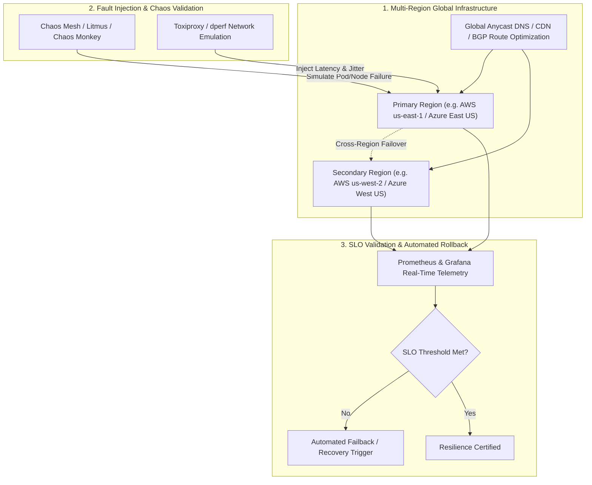

# Awesome Global High-Availability Test Data Centers

> A curated list of top global high-availability (HA) test data centers, multi-region cloud infrastructure, enterprise colocation ecosystems, chaos engineering platforms, and fault-injection frameworks.

---

## Table of Contents

- [Overview](#overview)
- [Sector Overview & Market Dynamics](#sector-overview--market-dynamics)
- [SaaS & Hosted Infrastructure Platforms](#saas--hosted-infrastructure-platforms)
- [Open-Source GitHub Projects](#open-source-github-projects)
- [Architecture & HA Testing Strategies](#architecture--ha-testing-strategies)
- [How to Contribute](#how-to-contribute)
- [Disclaimer](#disclaimer)

---

## Overview

High-availability (HA) validation and disaster recovery (DR) simulations require two complementary pillars:
1. **Physical & Cloud Infrastructure**: Multi-region cloud environments, redundant availability zones (AZs), and interconnected colocation facilities where real-world network latency and failover topology exist.
2. **Chaos & Resilience Frameworks**: Open-source tools that inject controlled faults (pod termination, packet latency, network partitions, host failures) to rigorously test uptime and automatic failover before incidents hit production.

---

## Sector Overview & Market Dynamics

The global data center colocation and cloud infrastructure testing sector is valued at approximately **$91 billion to $101 billion in 2025–2026**, expanding at a compound annual growth rate (CAGR) of **9.3% to 11.4%** propelled by generative AI workloads, high-density compute demands, and mission-critical multi-region enterprise deployments. The industry exhibits a **concentrated, oligopolistic top tier** led by hyperscalers (Amazon AWS, Microsoft Azure, Google Cloud) and global colocation REIT giants (Equinix, Digital Realty) who control vital interconnection hubs and fiber ecosystems, surrounded by a **moderately fragmented long-tail** of regional colocation providers, modular data center operators, and private infrastructure consortiums.

---

## SaaS & Hosted Infrastructure Platforms

The following SaaS and hosted infrastructure providers offer global footprints, availability zones, and testing environments for high-availability deployments. Ranked in descending order by **Company Size (Market Capitalization / Valuation / Revenue)**.

| Product | Company Size (Market Cap / Valuation) | Pricing (Starting) | Free Tier / Trial Limits | Description |
|---|---|---|---|---|
| **[Microsoft Azure Regions](https://azure.microsoft.com/en-us/explore/global-infrastructure/geographies/)** | **~$3.2 Trillion** Market Cap ($281.7B+ Ann. Revenue) | Pay-as-you-go; B1ls VM from **$0.0052/hour** (~$3.80/month); B1s VM from **$0.0116/hour** | **12-month free tier**: 750 hours B1s Burstable VM, 5 GB blob storage; **$200 credit** valid for 30 days for new accounts. | **70+ regions and 400+ data centers**—broadest geographic reach. Multi-zone and paired-region architectures designed for cross-zone and cross-region disaster recovery testing. |
| **[Google Cloud Data Centers](https://cloud.google.com/about/locations)** | **~$2.4 Trillion** Market Cap ($350B+ Ann. Alphabet Revenue) | Pay-as-you-go; e2-micro VM from **$0.0084/hour** (~$6.11/month) depending on region | **Always Free tier**: 1 non-preemptible e2-micro VM per month (in select US regions), 30 GB standard disk; **$300 credit** valid for 90 days. | **Minimum 3 Availability Zones per general-purpose region**. Planetary-scale software-defined network (Andromeda) and multi-region storage (Spanner, GCS) for single-region failure validation. |
| **[AWS Global Infrastructure](https://aws.amazon.com/about-aws/global-infrastructure/)** | **~$2.2 Trillion** Market Cap ($105.9B+ Ann. AWS Revenue) | Pay-as-you-go; t4g.nano from **$0.0042/hour** (~$3.07/month); t2.micro from **$0.0104/hour** | **12-month free tier**: 750 hours t2.micro/t3.micro per month; **$200 credits** via AWS Activate / new sign-ups. | **39 geographic regions, 124 availability zones**. Each region contains $\ge 3$ physically distinct, isolated AZs connected via low-latency private redundant dark fiber. |
| **[Equinix](https://www.equinix.com/data-centers)** | **~$85 Billion** Market Cap ($9.2B+ Ann. Revenue) | Enterprise quote; baseline standard full-cabinet colocation starts from **~$1,200/month** (subject to power/metro density) | **No self-service free tier**; enterprise Proof of Concept (PoC) and guided data center lab tours available via sales consultation. | **280+ data centers across 70+ metros in 33+ countries**. World's densest carrier-neutral colocation provider; features Equinix Fabric for multi-cloud HA cross-connections. |
| **[Digital Realty](https://www.digitalrealty.com/)** | **~$53 Billion** Market Cap ($6.1B+ Ann. Revenue) | Enterprise quote; baseline standard cabinet colocation starts from **~$1,100/month** (subject to kW allocation and cross-connects) | **No self-service free tier**; hands-on sandbox testing via Digital Realty Innovation Labs (DRIL) in VA, London, Japan, and Singapore by reservation. | **300+ data centers across 55+ metros in 30+ countries**. PlatformDIGITAL orchestration enables wholesale and AI-scale multi-rack high-availability stress testing. |
| **[NTT Global Data Centers](https://www.datacenterglobal.com/)** | **~$25 Billion** Market Cap ($30B+ Ann. NTT DATA Sales) | Enterprise quote; full 47U rack space starts from **~€550 to €1,400/month** (~$600–$1,500/month) based on kW commitment | **No standard free tier**; sponsored Proof of Concept (PoC) testing available via NTT DATA AI Factory lab hubs (e.g., Munich MUC2 campus). | **2GW+ power capacity across 20+ global regions**. Enterprise-grade colocation campuses with deep telco backbones across EMEA, APAC, and the Americas. |
| **[Switch](https://www.switch.com/)** | **~$19 Billion** Enterprise Valuation ($11B private buyout, multi-billion ABS program) | Enterprise quote; baseline high-density cabinet colocation starts from **~$1,500/month** (driven by 5kW–40kW+ power density packages) | **No self-service free tier**; on-site guided architectural evaluations and custom proof-of-concept allocations via sales validation. | Ultra-resilient Tier 5 Platinum data center campuses across Nevada, Michigan, Georgia, and Texas, built with 100% renewable power and 2N+2 power-grid topologies. |
| **[CyrusOne](https://www.cyrusone.com/)** | **~$15 Billion** Valuation ($15B acquisition by KKR & GIP; ~$1.3B Ann. Revenue) | Enterprise quote; standard baseline rack space starts from **~$1,000/month** (heavily dependent on kW commitments) | **No public free tier**; enterprise qualification required for pre-production sandbox tests and lab tours through CyrusOne engineering. | **50+ high-density hyperscale facilities across North America and Europe**. Focuses on massive power redundancy and custom high-density AI clusters. |
| **[Lumen Technologies](https://www.lumen.com/en-in/services/colocation.html)** | **~$5 Billion** Market Cap ($12.4B Ann. Revenue) | Enterprise quote; standard rack colocation starts from **~$950/month** (excluding dedicated bandwidth and cross-connect charges) | **No self-service free tier**; enterprise network & edge testing evaluations available through Lumen Solutions Architecture teams. | **72+ facilities in APAC, 25 colocation metros**, direct integration with the Lumen Tier-1 global IP backbone for network-layer HA redundancy testing. |
| **[BrowserStack](https://www.browserstack.com/data-centers)** | **~$4 Billion** Private Valuation (~$225M Ann. Revenue) | Live Desktop plan starts at **$29/month** (annual billing) or **$39/month** (monthly billing); Live Desktop & Mobile at **$39/month** | **Free Trial**: **30 minutes** of Live interactive manual testing (capped at 1 minute per real device); **100 minutes** of automated test runs. | **19 physical test data centers across 13 global metros** (US, EU, APAC) housing 3,500+ real iOS, Android, macOS, and Windows hardware endpoints for geo-distributed failover testing. |

---

## Open-Source GitHub Projects

Community-driven chaos engineering frameworks, failure injectors, and network resilience validation tools. Sorted in descending order by **GitHub Star Count**.

| Project | Stars | Focus Area | Description |
|---|---|---|---|
| **[Chaos Monkey](https://github.com/Netflix/chaosmonkey)** |  | Instance & VM Resiliency | The pioneer of chaos engineering created by Netflix. Automatically terminates virtual machine instances and containers in pre-production and production clusters to verify service redundancy and seamless failover. |
| **[Toxiproxy](https://github.com/Shopify/toxiproxy)** |  | Network Simulation & Latency | Developed by Shopify. A TCP proxy specifically crafted to simulate unstable network conditions (latency, jitter, bandwidth throttling, connection timeouts, and packet manipulation) for resilient multi-datacenter testing. |
| **[Chaos Mesh](https://github.com/chaos-mesh/chaos-mesh)** |  | Cloud-Native Kubernetes Chaos | CNCF graduated chaos orchestration platform for Kubernetes. Supports fault injection across pods, networks, file I/O, system time, JVM, stress testing, and physical nodes with a dedicated dashboard. |
| **[LitmusChaos](https://github.com/litmuschaos/litmus)** |  | Kubernetes & Multi-Cloud HA | CNCF incubating chaos engineering framework. Provides a complete Chaos Control Plane (`chaos-center`), CRD-based experiment definitions, declarative Steady-State probes, and pre-built experiment catalogs via ChaosHub. |
| **[dperf](https://github.com/baidu/dperf)** |  | High-Performance Network Load | DPDK-based high-performance network load tester capable of generating tens of millions of concurrent connections, hundreds of Gbps throughput, and detailed packet drop analytics for validating Layer 4 load balancer failover. |
| **[Pumba](https://github.com/alexei-led/pumba)** |  | Docker Container Chaos | Chaos testing tool and network emulator for Docker containers. Injects crashes, pause commands, container kills, and uses Linux Traffic Control (`tc`) to inject network delay, loss, and corruption directly into containers. |
| **[PowerfulSeal](https://github.com/powerfulseal/powerfulseal)** |  | Autonomous Kubernetes Chaos | Developed by Bloomberg. A chaos engineering tool for Kubernetes clusters that injects failure into both pods and host nodes (supporting AWS, Azure, OpenStack, and bare metal) using autonomous policy modes. |
| **[chaoskube](https://github.com/linki/chaoskube)** |  | Pod Termination Chaos | Lightweight, periodic pod disruption agent for Kubernetes. Filter targets by namespaces, labels, and annotations while excluding critical production workloads to ensure continuous microservice redundancy. |
| **[Krkn](https://github.com/krkn-chaos/krkn)** |  | Kubernetes Resiliency & OpenShift | CNCF sandbox chaos and resiliency framework (formerly Kraken). Injects node failure, pod termination, time skew, and network disruption scenarios to validate OpenShift and Kubernetes cluster failover. |

---

## Architecture & HA Testing Strategies

To achieve true five-nines (99.999%) availability, architect your testing strategy across three distinct failure zones:

---

## How to Contribute

We welcome additions, corrections, and new tool submissions!
1. **Fork** this repository.
2. **Add or update** entries in `README.md` adhering to the standard markdown table schema.
3. For SaaS platforms: include pricing starting tiers, explicit free tier / trial limits, company valuation or revenue, and relevant architectural specs.
4. For Open-Source projects: provide the GitHub repo link and ensure the social star badge (`style=social&color=white`) points to `https://github.com/{org}/{repo}/stargazers`.
5. Open a **Pull Request** with a concise description of your changes.

---

## Disclaimer

- This curated list is maintained for educational and architectural reference purposes only.
- Inducing chaos experiments, network disruption, and node termination can cause unintended service interruptions; always validate blast radius isolation, ensure automated fallback procedures are operational, and test in non-production environments prior to production stress tests.
